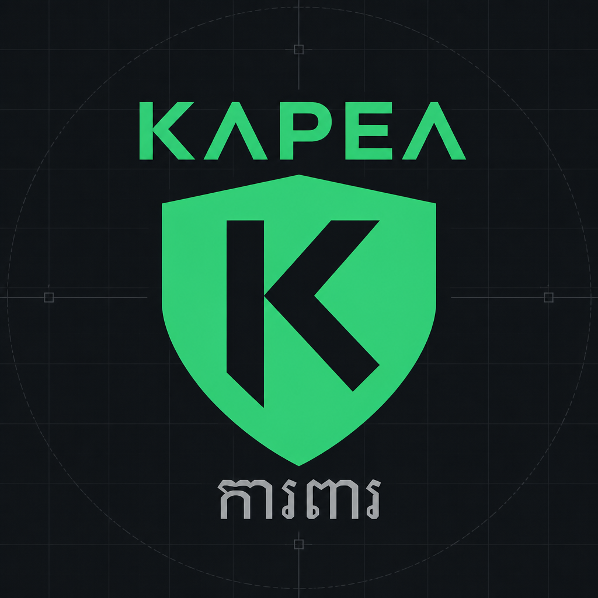

<p align="center">
  
</p>

<h1 align="center">KAPEA</h1>

<p align="center">
  Open-source malware file scanning platform.<br/>
  NestJS control plane · Rust scan workers · BullMQ · PostgreSQL · object storage
</p>

Uploaded files are never executed in NestJS. All scanning happens in restricted Rust workers.

> Operator portal and Telegram bot are **not** included here. This repository is the reusable scanning core.

## Layout

```text
apps/
  api/                 NestJS public + admin API
  result-consumer/     Persists BullMQ scan results
  retention-worker/    Scheduled quarantine deletion
rust/
  scan-worker/         Hostile-file scanners (ClamAV, YARA, archives, …)
packages/
  contracts/           Versioned event schemas (Zod)
  database/            Prisma schema + Nest module
  messaging/           BullMQ queue module
  storage/             MinIO / S3 / GCS / Azure adapters
  common/ …            Shared helpers and observability
infrastructure/
  docker/              Dockerfiles + Compose
  kubernetes/          Production manifests
  yara/                Sample YARA rules
docs/                  Architecture, API, security, storage
test-fixtures/         Clean / EICAR / suspicious samples
```

## Prerequisites

- Node.js 20+
- pnpm 9+
- Rust 1.75+ (stable)
- Docker + Docker Compose
- Optional: [rarlab `unrar`](https://www.rarlab.com/rar_add.htm) and `7z` for archive fixtures

## Development

### 1. Install and configure

```bash
pnpm install
cp .env.example .env
pnpm --filter @kapea/database prisma:generate
```

### 2. Start the local stack

**Hybrid (recommended on macOS):** Docker for postgres / redis / MinIO / ClamAV; API, result-consumer, and scan-worker on the host.

```bash
SKIP_E2E=1 pnpm stack:up
```

**Full Compose** (everything in Docker — slower first build):

```bash
pnpm stack:up:compose
```

Stop host apps (keep Docker infra): `pnpm stack:down`  
Tear down containers too: `pnpm stack:down:full`

### 3. Day-to-day commands

| Command | Purpose |
|---------|---------|
| `pnpm dev:api` | Nest API with watch |
| `pnpm dev:result-consumer` | Result consumer |
| `pnpm build` | Build Nest apps + packages |
| `pnpm build:rust` | Build `kapea-scan-worker` |
| `pnpm typecheck` / `pnpm test` | TS checks and unit tests |
| `pnpm test:rust` | Rust tests |
| `pnpm e2e` | Upload fixtures and assert verdicts |
| `pnpm scan:file -- <path> --pretty` | Offline single-file scan (no full stack) |

### 4. Useful endpoints

| URL | Notes |
|-----|-------|
| http://localhost:3000/health/live | API liveness |
| http://localhost:3000/metrics | Prometheus metrics |
| http://localhost:3000/api/docs | Swagger |
| http://localhost:9001 | MinIO console (`minioadmin` / `minioadmin`) |

Auth for admin routes uses `ADMIN_API_KEY` from `.env` (default `dev-admin-key`).

### 5. Offline scan without infra

```bash
pnpm scan:file -- test-fixtures/eicar/eicar.com.txt --pretty
```

ClamAV is skipped with an info log if unreachable; YARA and other analyzers still run.

```bash
docker compose -f infrastructure/docker/docker-compose.yml up -d clamav
```

Place `unrar` at `tools/bin/unrar` (gitignored) or set `UNRAR_PATH`. Set `SEVEN_Z_PATH` if `7z` is not on `PATH`.

### 6. Guidelines

- Prefer hybrid `stack:up` while iterating on Nest/Rust; use Compose when validating container images.
- Keep scan workers idempotent — BullMQ delivery is at-least-once.
- Incomplete scans must never return `CLEAN`.
- Do not commit `.env`, quarantine objects, or real malware samples beyond the intentional fixtures.
- Shared contracts live in `packages/contracts` — change events carefully and bump consumers together.
- More architecture detail: [docs/architecture.md](docs/architecture.md), [docs/events.md](docs/events.md), [docs/security.md](docs/security.md).

## Deployment

### Docker Compose

```bash
cp .env.example .env   # set strong secrets before any shared environment
docker compose -f infrastructure/docker/docker-compose.yml up -d --build
```

Build context is the repository root. The API container runs `prisma migrate deploy` on startup (`RUN_MIGRATIONS=false` to skip).

| Service | Default port |
|---------|--------------|
| api | 3000 |
| result-consumer | 3001 |
| retention-worker | 3003 |
| scan-worker | — (queue consumer) |
| postgres / redis / minio / clamav | compose defaults |
| prometheus / grafana | 9090 / 3301 (compose profile) |

### Kubernetes

Manifests: `infrastructure/kubernetes/`.

```bash
kubectl apply -f infrastructure/kubernetes/namespace.yaml
kubectl apply -f infrastructure/kubernetes/configmap.yaml
# copy secret.example.yaml → secret.yaml, fill values, then:
kubectl apply -f infrastructure/kubernetes/secret.yaml
kubectl create configmap kapea-yara-rules \
  --from-file=infrastructure/yara/rules -n kapea \
  --dry-run=client -o yaml | kubectl apply -f -
kubectl apply -f infrastructure/kubernetes/deployment-api.yaml
kubectl apply -f infrastructure/kubernetes/deployment-result-consumer.yaml
kubectl apply -f infrastructure/kubernetes/deployment-retention-worker.yaml
kubectl apply -f infrastructure/kubernetes/deployment-rust-scan-worker.yaml
kubectl apply -f infrastructure/kubernetes/hpa.yaml
kubectl apply -f infrastructure/kubernetes/networkpolicy.yaml
```

Replace `REGISTRY` image placeholders. Build examples:

```bash
docker build -f infrastructure/docker/Dockerfile.api -t REGISTRY/kapea-api:latest .
docker build -f infrastructure/docker/Dockerfile.result-consumer -t REGISTRY/kapea-result-consumer:latest .
docker build -f infrastructure/docker/Dockerfile.retention-worker -t REGISTRY/kapea-retention-worker:latest .
docker build -f infrastructure/docker/Dockerfile.scan-worker -t REGISTRY/kapea-scan-worker:latest .
```

Scan workers should run with the provided seccomp/AppArmor profiles. See [docs/deployment.md](docs/deployment.md) and [infrastructure/kubernetes/README.md](infrastructure/kubernetes/README.md).

### Production checklist

- [ ] Rotate `API_KEY`, `ADMIN_API_KEY`, `JWT_SECRET`, DB, and object-store credentials
- [ ] Set `REQUIRE_API_KEY=true`
- [ ] Use a private quarantine bucket (no public ACL)
- [ ] Mount production YARA rules; keep ClamAV definitions updating
- [ ] Restrict worker egress (network policy) and apply seccomp/AppArmor
- [ ] Scrape `/metrics`; optional `SENTRY_DSN` on the API
- [ ] Confirm retention-worker schedule matches your quarantine policy

Storage providers: [docs/storage.md](docs/storage.md).

## License

MIT — see [LICENSE](LICENSE).
